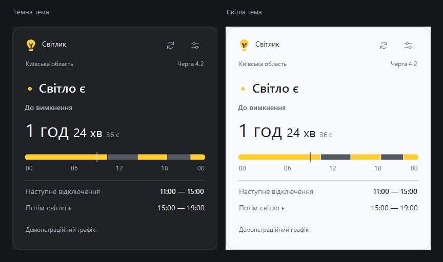

 

Windows 10 / 11 · Один EXE · Без інсталятора

[Сайт Світлика](https://denk0-ua.github.io/Svitlyk/) · [Усі версії та зміни](https://github.com/DenK0-UA/Svitlyk/releases) · [Зворотний зв’язок](https://t.me/DenK0_UA)

 

Демонстраційний графік. Темна та світла теми.

### Світло за графіком — без зайвих вікон

Світлик живе у системному треї, показує графік відключень і нагадує перед зміною світла.

| | |
| :--- | :--- |
| **Графік поруч** Поточний стан, час до зміни та розклад на добу. | **Ваша адреса** Пошук вулиці й будинку в Києві та Київській області. |
| **Нагадування завчасно** Оберіть, за скільки хвилин попереджати. | **Ваш стиль** Світла, темна або автоматична тема. |

### Почати просто

Завантажте **Svitlyk.exe** у постійну папку, запустіть та виберіть адресу. Наступні версії можна встановлювати прямо з налаштувань застосунку.

Світлик показує плановий графік. Фактичні відключення можуть відрізнятися.

---

Зробив **DenK0_UA** · [Написати в Telegram](https://t.me/DenK0_UA)
