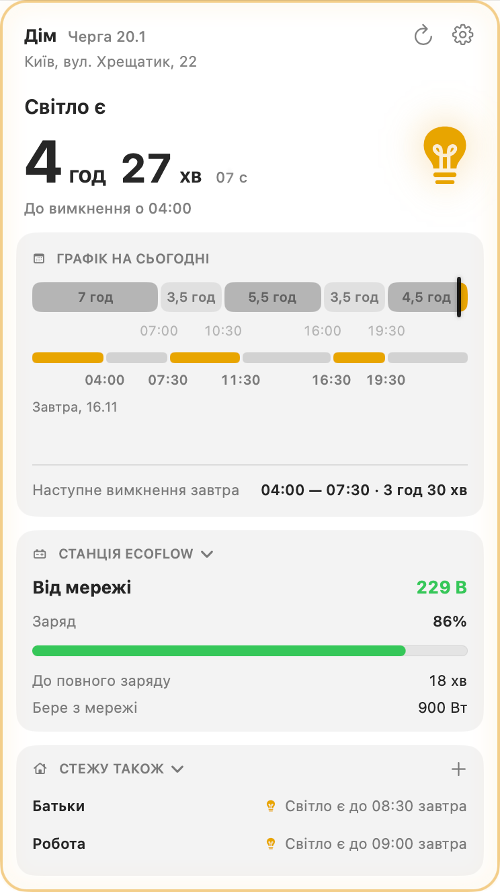

 

&nbsp;

**Windows 10 / 11** — один EXE, без інсталятора · **Mac** з M1 і новішими, macOS 26 і новіша

[Сайт Світлика](https://denk0-ua.github.io/Svitlyk/) · [Усі версії та зміни](https://github.com/DenK0-UA/Svitlyk/releases) · [Зворотний зв’язок](https://t.me/DenK0_UA)

 

Демонстраційний графік. Темна та світла теми.

### Світло за графіком — без зайвих вікон

Світлик тихо живе поруч із годинником: показує, чи має бути світло зараз, скільки лишилось до зміни і що буде далі. Перед вимкненням і ввімкненням — нагадає.

| | |
| :--- | :--- |
| **Графік поруч** Поточний стан, час до зміни та розклад на добу. | **Ваша адреса** Пошук вулиці й будинку в Києві та Київській області. |
| **Нагадування завчасно** Оберіть, за скільки хвилин попереджати. | **Кілька адрес** Стежте також за домом батьків чи роботою. |

---

### Світлик на Mac

 &nbsp; 

Ліворуч — світло є, станція заряджається. Праворуч — світла немає, а Світлик рахує, скільки протримається станція. Адреси вигадані.

На Mac Світлик — лампочка у верхньому рядку меню. Натисніть її, і відкриється панель із графіком, відліком і вашими адресами.

**А якщо вдома є зарядна станція EcoFlow,** Світлик під'єднається до неї через Bluetooth і знатиме, чи світло справді є, — не лише що каже графік. Зникло світло — одразу повідомить, дали — теж. Покаже заряд, напругу в мережі, скільки зараз споживає квартира і на скільки ще вистачить станції. А якщо відключення за графіком — підкаже, чи дотягнете до світла. Поки це працює з Delta 2 Max.

Нові версії Світлик пропонує сам: у панелі з'явиться кнопка «Оновити», і за кілька секунд усе готово.

---

### Почати просто

**Windows.** Завантажте **Svitlyk.exe**, покладіть його в постійну папку, запустіть і виберіть свою адресу. Нові версії Світлик запропонує сам.

**Mac.** Завантажте ZIP, відкрийте його й перетягніть Світлик у «Програми». Перший запуск потребує однієї команди в Терміналі — [ось як це зробити](https://github.com/DenK0-UA/Svitlyk/releases/tag/macos-v1.0.0), це хвилина. Далі все працює саме.

Світлик показує плановий графік і повідомлення ДТЕК. Фактичні відключення можуть відрізнятися.

---

Зробив **DenK0_UA** · [Написати в Telegram](https://t.me/DenK0_UA)
