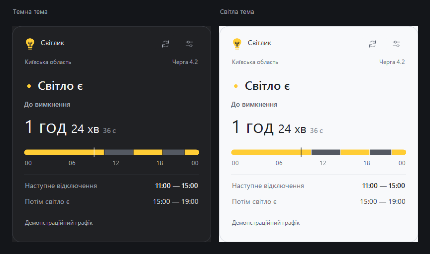

 

&nbsp;

**Windows 10 / 11** — один EXE, без інсталятора · **Mac** з M1 і новішими, macOS 26 і новіша

[Сайт Світлика](https://denk0-ua.github.io/Svitlyk/) · [Усі версії та зміни](https://github.com/DenK0-UA/Svitlyk/releases) · [Зворотний зв’язок](https://t.me/DenK0_UA)

 

Демонстраційний графік. Темна та світла теми.

### Світло за графіком — без зайвих вікон

Світлик живе у системному треї, показує графік відключень і нагадує перед зміною світла.

| | |
| :--- | :--- |
| **Графік поруч** Поточний стан, час до зміни та розклад на добу. | **Ваша адреса** Пошук вулиці й будинку в Києві та Київській області. |
| **Нагадування завчасно** Оберіть, за скільки хвилин попереджати. | **Ваш стиль** Світла, темна або автоматична тема. |

### Почати просто

**На Windows.** Завантажте **Svitlyk.exe**, покладіть його в постійну папку, запустіть і виберіть свою адресу. Нові версії Світлик запропонує сам.

**На Mac.** Завантажте ZIP, розпакуйте й перетягніть Світлик у «Програми». Перший запуск потребує однієї команди в Терміналі — [ось як це зробити](https://github.com/DenK0-UA/Svitlyk/releases/tag/macos-v1.0.0), це хвилина. Далі Світлик живе лампочкою вгорі екрана й оновлюється сам.

### А якщо вдома є зарядна станція

У версії для Mac Світлик уміє дивитися на станцію EcoFlow через Bluetooth. Тоді він знає не лише графік, а й чи світло справді є: одразу повідомить, коли його вимкнули чи дали, покаже заряд і скільки ще протримається станція. Поки це працює з Delta 2 Max.

Світлик показує плановий графік. Фактичні відключення можуть відрізнятися.

---

Зробив **DenK0_UA** · [Написати в Telegram](https://t.me/DenK0_UA)
